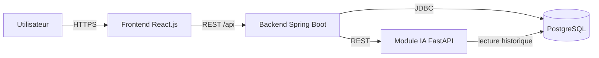

# Plateforme SEPA Intelligente (PFE)

Plateforme web intelligente de **génération, validation et contrôle des fichiers de virement bancaire SEPA (ISO 20022 XML)** à partir de schémas XSD, avec détection d'anomalies par intelligence artificielle et traçabilité complète des actions (audit trail).

## Architecture



| Service      | Technologie          | Port  | Dossier      |
|--------------|----------------------|-------|--------------|
| Frontend     | React.js + Vite      | 5173  | `frontend/`  |
| Backend      | Java 17 / Spring Boot| 8080  | `backend/`   |
| Module IA    | Python 3.11 / FastAPI| 8000  | `ai-module/` |
| Base données | PostgreSQL 16        | 5432  | (Docker)     |

## Fonctionnalités

1. Authentification (JWT) + reconnaissance faciale (webcam)
2. Gestion des utilisateurs et rôles (Administrateur, Gestionnaire RH, Validateur, Auditeur)
3. Journal d'audit (audit trail) de toutes les actions
4. Gestion des fichiers XSD (import, versions, analyse dynamique)
5. Génération automatique du XML SEPA (ISO 20022) à partir du XSD
6. Validation XML (syntaxe, XSD, champs obligatoires, types)
7. Contrôles métier RH (IBAN, BIC, salaires, doublons)
8. Module IA de détection d'anomalies (Isolation Forest, Local Outlier Factor)
9. Tableau de bord (statistiques, activités, anomalies)

## Démarrage rapide

### Avec Docker (recommandé)

```bash
docker compose up --build
```

### Manuellement

```bash
# 1. Base de données PostgreSQL (Docker)
docker compose up -d postgres

# 2. Backend
cd backend
./mvnw spring-boot:run

# 3. Module IA
cd ai-module
python -m venv .venv
.venv\Scripts\activate       # Windows
pip install -r requirements.txt
uvicorn app.main:app --reload --port 8000

# 4. Frontend
cd frontend
npm install
npm run dev
```

## Rôles et droits

| Rôle              | Import XSD | Génération XML | Validation | Approbation | Audit | Admin users |
|-------------------|:---------:|:--------------:|:----------:|:-----------:|:-----:|:-----------:|
| Administrateur    | ✅        | ✅             | ✅         | ✅          | ✅    | ✅          |
| Gestionnaire RH   | ✅        | ✅             | ✅         | ❌          | ❌    | ❌          |
| Validateur        | ❌        | ❌             | ✅         | ✅          | ❌    | ❌          |
| Auditeur          | ❌        | ❌             | ❌         | ❌          | ✅    | ❌          |

## Structure du dépôt

```
projet-Zina-PFE/
├── backend/      # API REST Spring Boot
├── frontend/     # Application React
├── ai-module/    # Service IA FastAPI
├── docker-compose.yml
└── README.md
```

## Module IA — Détection des montants suspects

Module additif basé sur **Isolation Forest** qui attribue un score de risque aux
paiements et signale les **montants incohérents** (complément des contrôles métier
Java qui gèrent déjà IBAN invalides et doublons).

**Features par paiement** : `montant`, `ecart_moyenne_salarie` (montant ÷ moyenne des
6 derniers mois), `zscore_client` (écart vs autres salariés du client),
`variation_mois_precedent`, `iban_change_recent`, `nb_paiements_meme_iban`.

**Endpoints (service Python, port 8000)** :

| Méthode | Route | Rôle |
|---------|-------|------|
| GET  | `/model/health`      | état + version du modèle |
| POST | `/anomalies/detect`  | score par paiement + raisons lisibles |
| POST | `/model/train`       | réentraîne le modèle (données fournies ou synthétiques) |

**Endpoints backend** :

| Méthode | Route | Accès |
|---------|-------|-------|
| POST | `/api/ai/detect`        | RH / Validateur / Admin — lance la détection |
| GET  | `/api/admin/ai/health`  | Administrateur — supervision |
| POST | `/api/admin/ai/train`   | Administrateur — réentraînement |

**Interrupteur & configuration** (backend `application.yml` / variables d'env) :

```yaml
app:
  ai:
    enabled: true        # false = aucun appel IA, traitement inchangé
    url: http://localhost:8000
    timeout-ms: 5000     # au-delà : avertissement loggé, traitement poursuivi
    score-threshold: 0.6
    history-months: 6
```

Paramètres du modèle côté Python (variables d'env, réglables par l'administrateur) :
`AI_CONTAMINATION`, `AI_SCORE_THRESHOLD`, `AI_HISTORY_MONTHS`, `AI_N_ESTIMATORS`.

**Lancement**

Le service est déjà dans `docker-compose.yml` (port 8000). En local sans Docker :

```bash
cd ai-module
pip install -r requirements.txt
uvicorn app.main:app --port 8000
```

**Entraîner / évaluer / tester** (depuis `ai-module/`) :

```bash
python -m scripts.generate_synthetic_data   # génère un CSV de démonstration
python -m scripts.evaluate                   # précision / rappel / F1 vs règle simple
pytest                                        # tests features + endpoint /anomalies/detect
```

