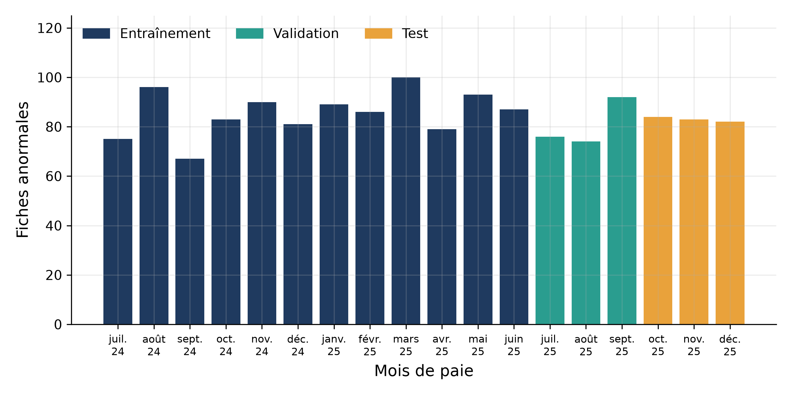

# Évaluation du module IA de contrôle des fichiers de paie

Rapport d'évaluation généré par `ai-module/benchmark`. Reproduction : voir les commandes en fin de document.

## 1. Objectif et organisation

Le module IA contrôle les fichiers de paie avant la génération des virements SEPA : il attribue à chaque fiche un score
de suspicion et des raisons lisibles, à partir d'un modèle Isolation Forest et de règles métier. Ce document évalue ce
module de façon rigoureuse (découpage chronologique, seuil choisi sur la validation, résultats finaux sur le test,
cinq graines) en quatre étapes : 0 jeu de données, A évaluation du modèle, B comparaison des approches, C intégration
dans l'application. *Les sections correspondant aux étapes A, B et C seront ajoutées au fur et à mesure.*

## 2. Jeu de données

### 2.1 Méthode de génération et limites

**Légende proposée** : Méthode de génération du jeu de données synthétique et limites.

**Interprétation** : Le générateur simule la paie mois par mois. Chaque salarié a un salaire de base lié à son profil et à sa société, un bruit mensuel d'environ 1 %, une augmentation annuelle en janvier, des promotions occasionnelles, des primes ponctuelles normales, un 13e mois en décembre pour trois sociétés, des changements d'IBAN légitimes, des entrées et des sorties. Des anomalies de neuf types sont ensuite injectées à un taux d'environ 2 % des fiches et étiquetées. Les IBAN sont valides (clés RIB et IBAN calculées en modulo 97) et les noms viennent de Faker en localisation française, avec une graine fixée. Limites : les données sont synthétiques et les anomalies sont injectées par des règles que l'on connaît, ce qui peut favoriser les approches qui exploitent les mêmes signaux ; l'historique est supposé correct (les anomalies d'un mois ne contaminent pas le suivant) ; les salaires suivent des lois simples. Les résultats mesurent donc la capacité à retrouver des anomalies plausibles et non la performance sur de vraies données de paie, qui devra être confirmée par un pilote.

### 2.2 Description du jeu de données

| Caractéristique | Valeur |
| :--- | ---: |
| Sociétés | 9 |
| Salariés distincts (hors fantômes) | 4 621 |
| Effectif mensuel moyen | 4 003 |
| Entrées / sorties sur la période | 631 / 505 |
| Mois de paie | 18 (juil. 2024 – déc. 2025) |
| Fiches de paie | 73 568 |
| Fiches anormales étiquetées | 1 517 (2,06 %) |
| Types d'anomalies | 9 |
| Fiches normales atypiques : primes | 749 |
| Fiches normales atypiques : 13e mois | 1 986 |
| Fiches normales atypiques : changements d'IBAN légitimes | 152 |

*Description du jeu de données synthétique de référence.*

**Légende proposée** : Description du jeu de données synthétique de référence (graine 42).

**Interprétation** : Le jeu de référence simule 9 sociétés et 4 621 salariés distincts sur 18 mois de paie, soit 73 568 fiches. Environ 2,1 % des fiches (1 517) portent une anomalie étiquetée, ce qui reproduit le fort déséquilibre de classes d'un contexte réel et justifie l'usage de la PR-AUC plutôt que de l'exactitude. Les mouvements de personnel (631 entrées et 505 sorties) créent des salariés sans historique, y compris légitimes. Le jeu contient aussi des fiches normales mais atypiques (749 primes, 1 986 versements de 13e mois et 152 changements d'IBAN légitimes) qui servent de cas difficiles : un bon modèle doit les laisser passer.

### 2.3 Découpage chronologique

| Jeu | Mois | Fiches | Anomalies | Taux d'anomalies |
| :--- | ---: | ---: | ---: | ---: |
| Entraînement | 1–12 | 48 791 | 1 026 | 2,10 % |
| Validation | 13–15 | 12 354 | 242 | 1,96 % |
| Test | 16–18 | 12 423 | 249 | 2,00 % |

*Découpage chronologique du jeu de données par mois de paie.*

**Légende proposée** : Découpage chronologique : entraînement (mois 1 à 12), validation (13 à 15), test (16 à 18).

**Interprétation** : Le découpage suit l'ordre du temps et non un tirage aléatoire : le modèle est entraîné sur les mois 1 à 12, le seuil de décision est choisi sur les mois 13 à 15 et les résultats finaux sont mesurés sur les mois 16 à 18, jamais vus. Ce protocole reproduit l'usage réel, où l'on contrôle la paie d'un mois à venir avec un modèle appris sur le passé, et évite toute fuite d'information entre jeux. Les trois jeux ont des taux d'anomalies voisins (2,10 %, 1,96 % et 2,00 %), avec 249 anomalies dans le jeu de test, effectif suffisant pour des taux de détection par type stables lorsqu'ils sont moyennés sur plusieurs graines. Le jeu de test se termine en décembre : il contient le 13e mois de trois sociétés, dont le modèle n'a vu qu'un seul exemple annuel (décembre 2024) à l'entraînement.



**Légende proposée** : Nombre de fiches anormales par mois de paie, coloré selon le jeu (entraînement, validation, test).

**Interprétation** : Les anomalies sont réparties de façon régulière dans le temps, ce qui évite qu'un jeu ne soit artificiellement plus facile qu'un autre : on compte de 67 à 100 fiches anormales par mois. Le découpage chronologique place l'entraînement sur les douze premiers mois, la validation sur les trois suivants et le test sur les trois derniers. Le bruit entre mois reflète le caractère aléatoire de l'injection ; il est absorbé par la répétition sur plusieurs graines.

### 2.4 Sociétés simulées

| Société | Raison sociale (fictive) | Salariés | Employés / cadres / dirigeants | 13e mois | Fiches | Anomalies |
| :--- | :--- | ---: | ---: | :---: | ---: | ---: |
| SOC-01 | Laurent et Fils | 1 159 | 862 / 261 / 36 | non | 18 380 | 331 |
| SOC-02 | Moulin | 927 | 739 / 163 / 25 | non | 14 809 | 275 |
| SOC-03 | Joly Gallet SA | 692 | 501 / 168 / 23 | oui | 10 971 | 253 |
| SOC-04 | Maury S.A.R.L. | 592 | 437 / 144 / 11 | non | 9 273 | 179 |
| SOC-05 | Martinez SA | 455 | 326 / 122 / 7 | non | 7 310 | 168 |
| SOC-06 | Rey Bodin S.A.S. | 340 | 265 / 68 / 7 | oui | 5 415 | 119 |
| SOC-07 | Guilbert S.A. | 227 | 166 / 55 / 6 | non | 3 794 | 105 |
| SOC-08 | Vasseur | 135 | 101 / 30 / 4 | non | 2 147 | 50 |
| SOC-09 | Pruvost | 94 | 62 / 25 / 7 | oui | 1 469 | 37 |

*Sociétés simulées : effectifs, profils, 13e mois et anomalies injectées.*

**Légende proposée** : Sociétés simulées : effectifs, répartition des profils, 13e mois et anomalies.

**Interprétation** : Les 9 sociétés couvrent des tailles très différentes, de 94 à 1 159 salariés, afin que les statistiques de comparaison au sein d'une société (z-score) reposent sur des effectifs variés. Chaque société a son niveau de salaire de base et sa propre répartition employés, cadres et dirigeants. Trois sociétés versent un 13e mois en décembre, ce qui double leur fiche de paie ce mois-là. Les anomalies sont réparties proportionnellement aux effectifs. Les raisons sociales sont fictives, générées avec la bibliothèque Faker en localisation française.

### 2.5 Salaires par profil


**Légende proposée** : Distribution du montant net mensuel des fiches normales selon le profil du salarié (hors 13e mois).

**Interprétation** : Les trois profils occupent des plages de salaire nettement distinctes, avec des médianes de 2 177 € pour les employés, 4 160 € pour les cadres et 9 686 € pour les dirigeants. L'échelle logarithmique rend visible la queue des dirigeants sans écraser les employés. Un même montant peut être normal pour un dirigeant et suspect pour un employé : un seuil global sur le montant est donc inopérant. C'est la raison d'être des variables relatives du modèle (écart à l'historique du salarié, comparaison aux autres salariés de la société). Les distributions se recouvrent peu ; seuls les employés les mieux payés et les cadres les moins payés se rejoignent autour de 3 000 €.

### 2.6 Anomalies injectées

| Type d'anomalie | Entraînement | Validation | Test | Total | Principe d'injection |
| :--- | ---: | ---: | ---: | ---: | :--- |
| Montant multiplié par 3 à 10 | 98 | 31 | 24 | 153 | Montant légitime × tirage uniforme dans [3 ; 10] |
| Erreur de virgule (×100 ou ÷100) | 121 | 31 | 24 | 176 | Montant légitime × 100 ou ÷ 100 (une chance sur deux) |
| Hausse subtile (+25 à +60 %) | 115 | 27 | 27 | 169 | Montant légitime × tirage uniforme dans [1,25 ; 1,60] |
| Montant nul ou négatif | 105 | 28 | 35 | 168 | Montant égal à 0 ou à l'opposé du montant légitime |
| Doublon (salarié payé deux fois) | 128 | 30 | 26 | 184 | Fiche recopiée à l'identique ; les deux fiches sont étiquetées |
| IBAN modifié et montant élevé | 123 | 27 | 31 | 181 | Nouvel IBAN valide et montant légitime × [1,5 ; 3] |
| IBAN partagé entre deux salariés | 132 | 30 | 22 | 184 | Un salarié reprend l'IBAN d'un collègue ; les deux fiches sont étiquetées |
| Salarié fantôme (sans historique) | 109 | 21 | 27 | 157 | Nouveau salarié sans historique, salaire plausible (× [0,9 ; 1,5] du salaire type) |
| Salarié sorti encore payé | 95 | 17 | 33 | 145 | Salarié parti depuis 2 à 4 mois, payé à nouveau à son salaire habituel |
| Total | 1 026 | 242 | 249 | 1 517 |  |

*Anomalies étiquetées par type et par jeu (nombre de fiches).*

**Légende proposée** : Anomalies étiquetées par type et par jeu ; la dernière colonne rappelle le principe d'injection.

**Interprétation** : Neuf types d'anomalies sont injectés, des plus évidentes (montant multiplié, montant négatif ou nul) aux plus difficiles (hausse de 25 à 60 %, salarié fantôme, salarié sorti encore payé), qui ressemblent à des situations légitimes. Les doublons et les IBAN partagés étiquettent les deux fiches concernées, car l'Expert RH doit examiner la paire. Ces types sont tirés deux fois moins souvent que les autres pour que les effectifs par type restent comparables. Le jeu de test contient entre 22 et 35 fiches par type, ce qui reste modeste : l'étape d'évaluation répète donc les mesures sur cinq graines et rapporte moyenne et écart-type.

## Reproduction

Depuis le dossier `ai-module/` (environnement virtuel avec `pip install -r benchmark/requirements-benchmark.txt`) :

```
python -m benchmark.describe_dataset      # étape 0 : jeu de données, tableaux, figures, scénario de soutenance
```
