# Évaluation du module IA de contrôle des fichiers de paie

Rapport d'évaluation généré par `ai-module/benchmark`. Reproduction : voir les commandes en fin de document.

## 1. Objectif et organisation

Le module IA contrôle les fichiers de paie avant la génération des virements SEPA : il attribue à chaque fiche un score
de suspicion et des raisons lisibles, à partir d'un modèle Isolation Forest et de règles métier. Ce document évalue ce
module de façon rigoureuse (découpage chronologique, seuil choisi sur la validation, résultats finaux sur le test,
cinq graines) en quatre étapes : 0 jeu de données, A évaluation du modèle, B comparaison des approches, C intégration
dans l'application. *Les sections correspondant aux étapes A, B et C seront ajoutées au fur et à mesure.*

## 2. Jeu de données

### 2.1 Méthode de génération et limites

**Légende proposée** : Méthode de génération du jeu de données synthétique et limites.

**Interprétation** : Le générateur simule la paie mois par mois. Chaque salarié a un salaire de base lié à son profil et à sa société, un bruit mensuel d'environ 1 %, une augmentation annuelle en janvier, des promotions occasionnelles, des primes ponctuelles normales, un 13e mois en décembre pour trois sociétés, des changements d'IBAN légitimes, des entrées et des sorties. Des anomalies de neuf types sont ensuite injectées à un taux d'environ 2 % des fiches et étiquetées. Les IBAN sont valides (clés RIB et IBAN calculées en modulo 97) et les noms viennent de Faker en localisation française, avec une graine fixée. Limites : les données sont synthétiques et les anomalies sont injectées par des règles que l'on connaît, ce qui peut favoriser les approches qui exploitent les mêmes signaux ; l'historique est supposé correct (les anomalies d'un mois ne contaminent pas le suivant) ; les salaires suivent des lois simples. Les résultats mesurent donc la capacité à retrouver des anomalies plausibles et non la performance sur de vraies données de paie, qui devra être confirmée par un pilote.

### 2.2 Description du jeu de données

| Caractéristique | Valeur |
| :--- | ---: |
| Sociétés | 9 |
| Salariés distincts (hors fantômes) | 4 621 |
| Effectif mensuel moyen | 4 003 |
| Entrées / sorties sur la période | 631 / 505 |
| Mois de paie | 18 (juil. 2024 – déc. 2025) |
| Fiches de paie | 73 568 |
| Fiches anormales étiquetées | 1 517 (2,06 %) |
| Types d'anomalies | 9 |
| Fiches normales atypiques : primes | 749 |
| Fiches normales atypiques : 13e mois | 1 986 |
| Fiches normales atypiques : changements d'IBAN légitimes | 152 |

*Description du jeu de données synthétique de référence.*

**Légende proposée** : Description du jeu de données synthétique de référence (graine 42).

**Interprétation** : Le jeu de référence simule 9 sociétés et 4 621 salariés distincts sur 18 mois de paie, soit 73 568 fiches. Environ 2,1 % des fiches (1 517) portent une anomalie étiquetée, ce qui reproduit le fort déséquilibre de classes d'un contexte réel et justifie l'usage de la PR-AUC plutôt que de l'exactitude. Les mouvements de personnel (631 entrées et 505 sorties) créent des salariés sans historique, y compris légitimes. Le jeu contient aussi des fiches normales mais atypiques (749 primes, 1 986 versements de 13e mois et 152 changements d'IBAN légitimes) qui servent de cas difficiles : un bon modèle doit les laisser passer.

### 2.3 Découpage chronologique

| Jeu | Mois | Fiches | Anomalies | Taux d'anomalies |
| :--- | ---: | ---: | ---: | ---: |
| Entraînement | 1–12 | 48 791 | 1 026 | 2,10 % |
| Validation | 13–15 | 12 354 | 242 | 1,96 % |
| Test | 16–18 | 12 423 | 249 | 2,00 % |

*Découpage chronologique du jeu de données par mois de paie.*

**Légende proposée** : Découpage chronologique : entraînement (mois 1 à 12), validation (13 à 15), test (16 à 18).

**Interprétation** : Le découpage suit l'ordre du temps et non un tirage aléatoire : le modèle est entraîné sur les mois 1 à 12, le seuil de décision est choisi sur les mois 13 à 15 et les résultats finaux sont mesurés sur les mois 16 à 18, jamais vus. Ce protocole reproduit l'usage réel, où l'on contrôle la paie d'un mois à venir avec un modèle appris sur le passé, et évite toute fuite d'information entre jeux. Les trois jeux ont des taux d'anomalies voisins (2,10 %, 1,96 % et 2,00 %), avec 249 anomalies dans le jeu de test, effectif suffisant pour des taux de détection par type stables lorsqu'ils sont moyennés sur plusieurs graines. Le jeu de test se termine en décembre : il contient le 13e mois de trois sociétés, dont le modèle n'a vu qu'un seul exemple annuel (décembre 2024) à l'entraînement.


**Légende proposée** : Nombre de fiches anormales par mois de paie, coloré selon le jeu (entraînement, validation, test).

**Interprétation** : Les anomalies sont réparties de façon régulière dans le temps, ce qui évite qu'un jeu ne soit artificiellement plus facile qu'un autre : on compte de 67 à 100 fiches anormales par mois. Le découpage chronologique place l'entraînement sur les douze premiers mois, la validation sur les trois suivants et le test sur les trois derniers. Le bruit entre mois reflète le caractère aléatoire de l'injection ; il est absorbé par la répétition sur plusieurs graines.

### 2.4 Sociétés simulées

| Société | Raison sociale (fictive) | Salariés | Employés / cadres / dirigeants | 13e mois | Fiches | Anomalies |
| :--- | :--- | ---: | ---: | :---: | ---: | ---: |
| SOC-01 | Laurent et Fils | 1 159 | 862 / 261 / 36 | non | 18 380 | 331 |
| SOC-02 | Moulin | 927 | 739 / 163 / 25 | non | 14 809 | 275 |
| SOC-03 | Joly Gallet SA | 692 | 501 / 168 / 23 | oui | 10 971 | 253 |
| SOC-04 | Maury S.A.R.L. | 592 | 437 / 144 / 11 | non | 9 273 | 179 |
| SOC-05 | Martinez SA | 455 | 326 / 122 / 7 | non | 7 310 | 168 |
| SOC-06 | Rey Bodin S.A.S. | 340 | 265 / 68 / 7 | oui | 5 415 | 119 |
| SOC-07 | Guilbert S.A. | 227 | 166 / 55 / 6 | non | 3 794 | 105 |
| SOC-08 | Vasseur | 135 | 101 / 30 / 4 | non | 2 147 | 50 |
| SOC-09 | Pruvost | 94 | 62 / 25 / 7 | oui | 1 469 | 37 |

*Sociétés simulées : effectifs, profils, 13e mois et anomalies injectées.*

**Légende proposée** : Sociétés simulées : effectifs, répartition des profils, 13e mois et anomalies.

**Interprétation** : Les 9 sociétés couvrent des tailles très différentes, de 94 à 1 159 salariés, afin que les statistiques de comparaison au sein d'une société (z-score) reposent sur des effectifs variés. Chaque société a son niveau de salaire de base et sa propre répartition employés, cadres et dirigeants. Trois sociétés versent un 13e mois en décembre, ce qui double leur fiche de paie ce mois-là. Les anomalies sont réparties proportionnellement aux effectifs. Les raisons sociales sont fictives, générées avec la bibliothèque Faker en localisation française.

### 2.5 Salaires par profil

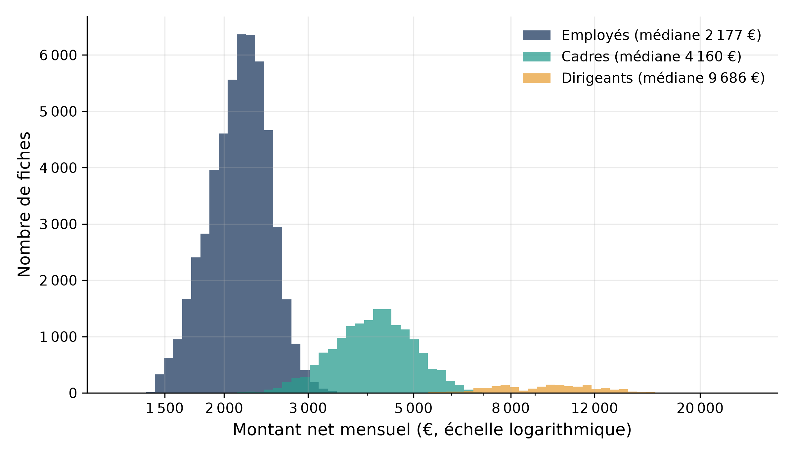

**Légende proposée** : Distribution du montant net mensuel des fiches normales selon le profil du salarié (hors 13e mois).

**Interprétation** : Les trois profils occupent des plages de salaire nettement distinctes, avec des médianes de 2 177 € pour les employés, 4 160 € pour les cadres et 9 686 € pour les dirigeants. L'échelle logarithmique rend visible la queue des dirigeants sans écraser les employés. Un même montant peut être normal pour un dirigeant et suspect pour un employé : un seuil global sur le montant est donc inopérant. C'est la raison d'être des variables relatives du modèle (écart à l'historique du salarié, comparaison aux autres salariés de la société). Les distributions se recouvrent peu ; seuls les employés les mieux payés et les cadres les moins payés se rejoignent autour de 3 000 €.

### 2.6 Anomalies injectées

| Type d'anomalie | Entraînement | Validation | Test | Total | Principe d'injection |
| :--- | ---: | ---: | ---: | ---: | :--- |
| Montant multiplié par 3 à 10 | 98 | 31 | 24 | 153 | Montant légitime × tirage uniforme dans [3 ; 10] |
| Erreur de virgule (×100 ou ÷100) | 121 | 31 | 24 | 176 | Montant légitime × 100 ou ÷ 100 (une chance sur deux) |
| Hausse subtile (+25 à +60 %) | 115 | 27 | 27 | 169 | Montant légitime × tirage uniforme dans [1,25 ; 1,60] |
| Montant nul ou négatif | 105 | 28 | 35 | 168 | Montant égal à 0 ou à l'opposé du montant légitime |
| Doublon (salarié payé deux fois) | 128 | 30 | 26 | 184 | Fiche recopiée à l'identique ; les deux fiches sont étiquetées |
| IBAN modifié et montant élevé | 123 | 27 | 31 | 181 | Nouvel IBAN valide et montant légitime × [1,5 ; 3] |
| IBAN partagé entre deux salariés | 132 | 30 | 22 | 184 | Un salarié reprend l'IBAN d'un collègue ; les deux fiches sont étiquetées |
| Salarié fantôme (sans historique) | 109 | 21 | 27 | 157 | Nouveau salarié sans historique, salaire plausible (× [0,9 ; 1,5] du salaire type) |
| Salarié sorti encore payé | 95 | 17 | 33 | 145 | Salarié parti depuis 2 à 4 mois, payé à nouveau à son salaire habituel |
| Total | 1 026 | 242 | 249 | 1 517 |  |

*Anomalies étiquetées par type et par jeu (nombre de fiches).*

**Légende proposée** : Anomalies étiquetées par type et par jeu ; la dernière colonne rappelle le principe d'injection.

**Interprétation** : Neuf types d'anomalies sont injectés, des plus évidentes (montant multiplié, montant négatif ou nul) aux plus difficiles (hausse de 25 à 60 %, salarié fantôme, salarié sorti encore payé), qui ressemblent à des situations légitimes. Les doublons et les IBAN partagés étiquettent les deux fiches concernées, car l'Expert RH doit examiner la paire. Ces types sont tirés deux fois moins souvent que les autres pour que les effectifs par type restent comparables. Le jeu de test contient entre 22 et 35 fiches par type, ce qui reste modeste : l'étape d'évaluation répète donc les mesures sur cinq graines et rapporte moyenne et écart-type.

## 3. Évaluation du modèle (étape A)

### 3.1 Protocole d'évaluation

**Légende proposée** : Protocole d'évaluation du modèle de détection.

**Interprétation** : Le jeu de données est découpé selon l'ordre chronologique des mois de paie : les mois 1 à 12 servent à entraîner le modèle, les mois 13 à 15 à choisir le seuil de décision, et les mois 16 à 18, jamais utilisés auparavant, à mesurer les performances finales. Ce découpage reproduit l'usage réel (contrôler un mois futur avec un modèle appris sur le passé) et interdit toute fuite d'information. Le modèle évalué est celui de l'application, reconstruit avec ses hyperparamètres (200 arbres, contamination de 1 %). Sa décision actuelle (prédiction native de l'Isolation Forest, ou score d'au moins 0,6, ou IBAN modifié) équivaut en pratique à « score d'au moins 0,5 ou IBAN modifié » : le seuil configuré à 0,6 est sans effet puisque la prédiction native signale déjà tout score supérieur à 0,5. Cette décision, fixée avant l'évaluation, est mesurée telle quelle, puis comparée à des variantes dont le seuil est choisi sur la validation (maximisation du F1) ; aucun paramètre n'est ajusté en regardant le test. Les mesures retenues sont la précision, le rappel, le F1, la ROC-AUC et la PR-AUC, ainsi que le nombre de faux positifs pour 1 000 fiches, qui traduit la charge de vérification de l'Expert RH. Comme les anomalies représentent environ 2 % des fiches, la ROC-AUC reste flatteuse (le grand nombre de fiches normales gonfle le taux de vrais négatifs) : la PR-AUC, dont la valeur de référence est le taux d'anomalies, est la mesure la plus pertinente. Chaque expérience est répétée sur cinq graines (jeu de données et modèle) et rapportée en moyenne ± écart-type.

### 3.2 Performances sur le jeu de test

| Configuration | Précision | Rappel | F1 | ROC-AUC | PR-AUC | Faux positifs / 1 000 fiches | Seuil |
| :--- | ---: | ---: | ---: | ---: | ---: | ---: | ---: |
| Décision actuelle en production (score ≥ 0,5 ou IBAN modifié) | 0,47 ± 0,09 | 0,38 ± 0,03 | 0,42 ± 0,05 | 0,84 ± 0,01 | 0,41 ± 0,04 | 8,9 ± 3,1 | 0,50 |
| Isolation Forest seul (seuil choisi sur la validation) | 0,15 ± 0,05 | 0,57 ± 0,09 | 0,23 ± 0,06 | 0,84 ± 0,01 | 0,41 ± 0,05 | 70,8 ± 21,2 | 0,34 ± 0,07 |
| Isolation Forest + règle IBAN modifié (seuil choisi sur la validation) | 0,16 ± 0,06 | 0,57 ± 0,09 | 0,24 ± 0,07 | 0,84 ± 0,01 | 0,33 ± 0,04 | 68,1 ± 22,4 | 0,34 ± 0,07 |

*Performances sur le jeu de test (mois 16 à 18), moyenne ± écart-type sur 5 graines. Référence au hasard : PR-AUC = taux d'anomalies (2,0 %), ROC-AUC = 0,50.*

**Légende proposée** : Performances du modèle sur le jeu de test (mois 16 à 18), moyenne ± écart-type sur 5 graines.

**Interprétation** : Avec sa décision actuelle (en pratique un seuil de 0,5 sur le score), le modèle en service atteint une précision de 0,47 ± 0,09, un rappel de 0,38 ± 0,03 et un F1 de 0,42 ± 0,05, soit environ 9 faux positifs pour 1 000 fiches. Sa PR-AUC de 0,41 ± 0,04 est environ 21 fois supérieure à celle d'un classement au hasard (2,0 %), ce qui prouve que le score contient une vraie information, mais elle reste loin de 1 : le modèle détecte environ 38 % des anomalies, pas toutes. Recalibrer le seuil sur la validation donne un seuil de 0,34 ± 0,07 et un rappel plus élevé (0,57 ± 0,09), mais au prix d'une précision de 0,15 ± 0,05 et de 71 faux positifs pour 1 000 fiches : le seuil appris sur des mois sans 13e mois ne se transfère pas au mois de décembre. Ajouter la règle IBAN dégrade la PR-AUC (0,33 ± 0,04 contre 0,41 ± 0,05 sans elle) car elle signale tous les changements d'IBAN légitimes, alors que le modèle repère déjà seul les changements d'IBAN accompagnés d'un montant élevé.

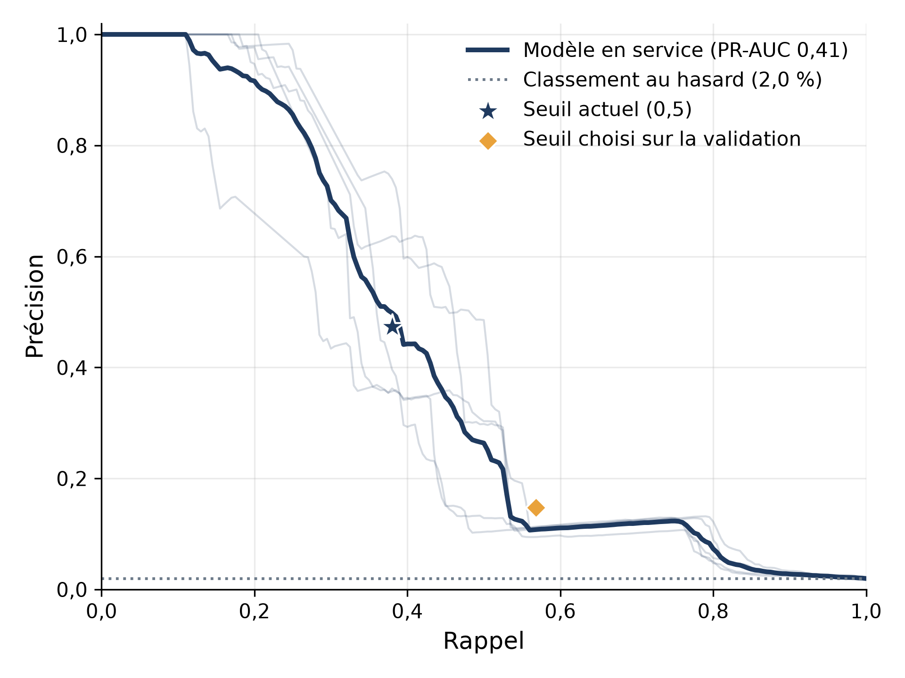

**Légende proposée** : Courbe précision–rappel du modèle en service sur le jeu de test (trait fin : chaque graine ; trait épais : moyenne).

**Interprétation** : La courbe précision–rappel décrit le compromis offert par le score, indépendamment du seuil. Elle reste nettement au-dessus du niveau du hasard (2,0 %), avec une PR-AUC de 0,41 ± 0,04. Les anomalies les mieux classées (jusqu'à un rappel d'environ 0,14) sont retrouvées avec une précision supérieure à 0,95, puis la précision décroît à mesure que l'on accepte de signaler davantage de fiches, jusqu'à un long palier d'environ 0,12 pour les rappels élevés, dû au bloc des 13e mois classés parmi les fiches suspectes. Le seuil actuel (étoile) offre une précision de 0,47 pour un rappel de 0,38 ; le seuil recalibré sur la validation (losange) gagne en rappel (0,57) en perdant beaucoup de précision (0,15). La dispersion entre graines est modérée, signe que le résultat ne dépend pas d'un tirage favorable.

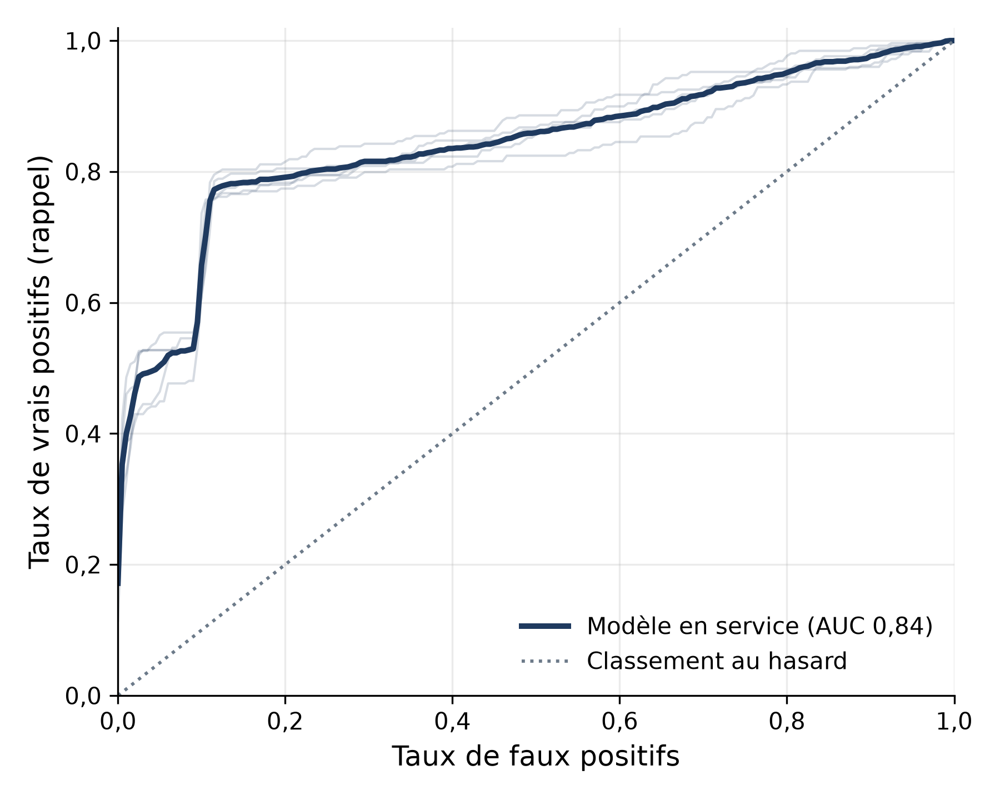

**Légende proposée** : Courbe ROC du modèle en service sur le jeu de test (trait fin : chaque graine ; trait épais : moyenne).

**Interprétation** : La courbe ROC s'écarte nettement de la diagonale, avec une aire de 0,84 ± 0,01. Autrement dit, une fiche anormale tirée au hasard reçoit un score plus élevé qu'une fiche normale dans environ 84 % des cas. Cette mesure doit toutefois être lue avec prudence : comme les fiches normales sont environ 50 fois plus nombreuses, un taux de faux positifs de quelques pourcents correspond déjà à beaucoup de fausses alertes en valeur absolue. C'est pourquoi la courbe précision–rappel, plus sensible au déséquilibre, est la référence de ce rapport. La ROC confirme néanmoins que le score ordonne correctement les fiches.

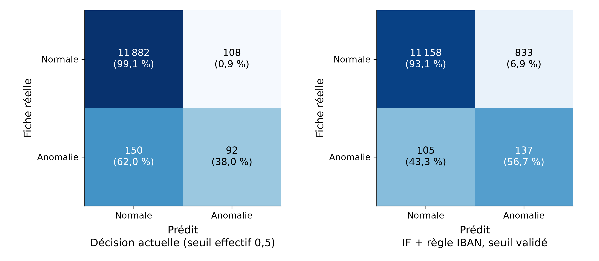

**Légende proposée** : Matrices de confusion moyennes sur le jeu de test (effectifs par graine et part de la ligne réelle).

**Interprétation** : À gauche, la décision actuelle signale en moyenne 92 anomalies vraies sur 241, et laisse passer 150 anomalies (faux négatifs). Les faux positifs sont peu nombreux en proportion (108 fiches sur plus de 12 000), ce qui ménage l'Expert RH. À droite, le seuil recalibré avec la règle IBAN détecte davantage d'anomalies mais produit 833 faux positifs en moyenne, soit une charge de vérification nettement supérieure. Le choix du seuil traduit donc un arbitrage entre anomalies manquées et temps de vérification, à fixer avec les utilisateurs.

### 3.3 Choix du seuil et distribution des scores

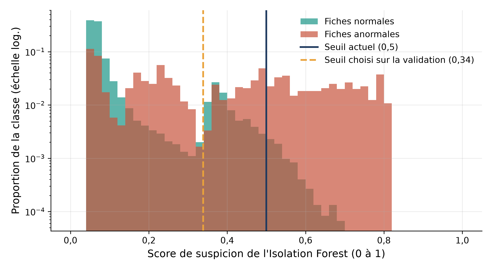

**Légende proposée** : Distribution des scores de l'Isolation Forest sur le jeu de test, selon la classe réelle.

**Interprétation** : La grande majorité des fiches normales a un score faible, avec toutefois un second regroupement autour de 0,4, qui correspond aux 13e mois (ces fiches représentent l'essentiel des faux positifs au seuil recalibré). Les anomalies s'étalent sur toute la plage, avec une queue marquée vers les scores élevés. Les deux distributions se recouvrent largement entre 0,2 et 0,6 : c'est la zone où se jouent les faux positifs et les faux négatifs. Au seuil actuel (0,5), peu de fiches normales sont signalées, mais une bonne part des anomalies, dont le score reste bas, passe inaperçue. Le seuil choisi sur la validation est plus bas et capte plus d'anomalies, mais il se place avant le regroupement des 13e mois et en signale donc presque toutes les fiches. L'échelle logarithmique rend visibles ces queues, invisibles sur une échelle linéaire.

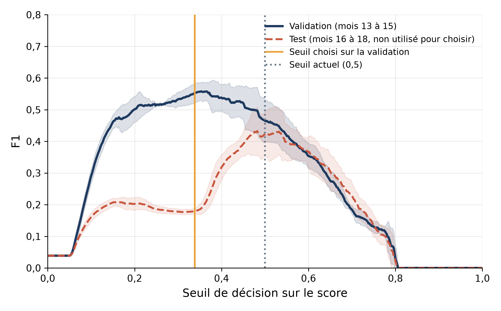

**Légende proposée** : F1 en fonction du seuil de décision, sur la validation (trait plein) et sur le test (tirets).

**Interprétation** : Sur la validation, le F1 atteint son maximum (0,56) pour un seuil d'environ 0,34, valeur retenue par le protocole. La courbe de test, tracée à titre de contrôle et jamais utilisée pour choisir, culmine à un seuil plus élevé (environ 0,48, F1 de 0,43) et ne donne que 0,18 au seuil choisi sur la validation : la validation (juillet à septembre) ne contient pas de 13e mois, alors que le test (octobre à décembre) en contient un. Le décalage entre les deux courbes est donc d'origine saisonnière et non un défaut de protocole. Il montre qu'un seuil unique appris sur peu de mois n'est pas robuste, et qu'il vaut mieux corriger la cause (variable de calendrier) que recalibrer en permanence. Le seuil actuel de 0,5 donne un F1 de 0,42 sur le test, proche de ce maximum, sans l'avoir été choisi sur ces données : ce bon résultat tient à un seuil prudent, pas à un réglage fin.

### 3.4 Détection par type d'anomalie

| Type d'anomalie | Fiches (test) | Décision actuelle (seuil effectif 0,5) | Isolation Forest, seuil validé |
| :--- | ---: | ---: | ---: |
| Montant multiplié par 3 à 10 | 26 | 98 ± 3 % | 100 ± 0 % |
| Erreur de virgule (×100 ou ÷100) | 24 | 57 ± 7 % | 100 ± 0 % |
| Hausse subtile (+25 à +60 %) | 28 | 3 ± 3 % | 26 ± 25 % |
| Montant nul ou négatif | 30 | 28 ± 17 % | 100 ± 0 % |
| Doublon (salarié payé deux fois) | 27 | 6 ± 9 % | 28 ± 37 % |
| IBAN modifié et montant élevé | 28 | 100 ± 0 % | 100 ± 0 % |
| IBAN partagé entre deux salariés | 23 | 57 ± 4 % | 66 ± 18 % |
| Salarié fantôme (sans historique) | 29 | 0 ± 0 % | 0 ± 0 % |
| Salarié sorti encore payé | 27 | 0 ± 0 % | 1 ± 2 % |

*Taux de détection (rappel) par type d'anomalie sur le jeu de test, moyenne ± écart-type sur 5 graines.*

**Légende proposée** : Taux de détection par type d'anomalie sur le jeu de test (rappel, moyenne ± écart-type sur 5 graines).

**Interprétation** : Le modèle détecte bien les anomalies qui déforment fortement le montant : Montant multiplié par 3 à 10, IBAN modifié et montant élevé (rappel d'au moins 80 % au seuil actuel), parce que l'écart à l'historique et le z-score dans la société deviennent extrêmes. Il détecte très mal Hausse subtile (+25 à +60 %), Doublon (salarié payé deux fois), Salarié fantôme (sans historique), Salarié sorti encore payé (rappel d'au plus 20 %). Pour la hausse subtile, la cause est de fond : une hausse de 25 à 60 % recouvre celle des primes et promotions normales, aucun modèle fondé sur le seul montant ne peut la distinguer sans faux positifs. Pour le salarié fantôme et le salarié sorti encore payé, l'information décisive (l'absence d'historique, l'absence de paiement le mois précédent) n'est pas dans les variables actuelles ; elle peut être ajoutée (la colonne correspondante est déjà fournie par le jeu de données). Le doublon demande une règle explicite sur l'identité des fiches, plus fiable que l'isolement statistique. Abaisser le seuil augmente le rappel de plusieurs types (par exemple montant nul ou négatif : 28 % puis 100 %) mais au prix de nombreux faux positifs.

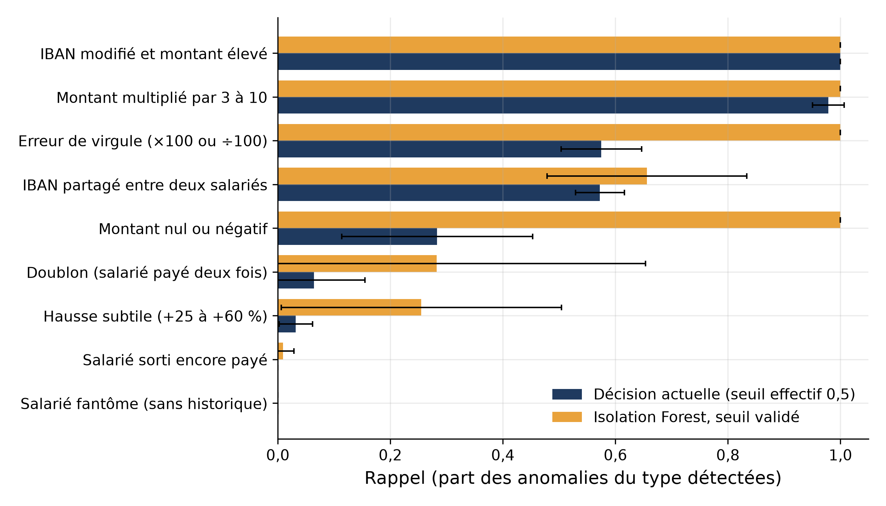

**Légende proposée** : Rappel par type d'anomalie sur le jeu de test (barres d'erreur : écart-type sur 5 graines).

**Interprétation** : Les types sont triés du moins bien au mieux détecté au seuil actuel. Le contraste est net : les erreurs qui défigurent le montant (multiplication, IBAN modifié avec montant élevé) sont presque toutes repérées, alors que le salarié fantôme, le salarié sorti encore payé, la hausse subtile et le doublon passent presque toujours inaperçus. Un seuil plus bas améliore le rappel de la plupart des types « montant » mais ne change rien aux deux types qui échappent à l'analyse des montants. Cela oriente les améliorations : des règles de cohérence pour les doublons et les montants nuls, de nouvelles variables pour les salariés fantômes et sortis, et un traitement spécifique de la saisonnalité.

### 3.5 Sensibilité à la saisonnalité et faux positifs

| Configuration | Période du test | Précision | Rappel | F1 | Faux positifs / 1 000 fiches |
| :--- | :--- | ---: | ---: | ---: | ---: |
| Décision actuelle (seuil effectif 0,5) | Octobre – novembre | 0,65 | 0,35 | 0,45 | 3,8 |
| Décision actuelle (seuil effectif 0,5) | Décembre (13e mois) | 0,34 | 0,45 | 0,38 | 19,1 |
| Isolation Forest, seuil validé | Octobre – novembre | 0,55 | 0,54 | 0,53 | 9,7 |
| Isolation Forest, seuil validé | Décembre (13e mois) | 0,07 | 0,63 | 0,12 | 193,3 |

*Performances avant et pendant décembre, où trois sociétés versent un 13e mois (moyenne sur 5 graines).*

**Légende proposée** : Performances avant et pendant décembre, mois du 13e mois de trois sociétés (moyenne sur 5 graines).

**Interprétation** : Les résultats se dégradent nettement en décembre : au seuil actuel, la précision passe de 0,65 (octobre et novembre) à 0,34 et les faux positifs pour 1 000 fiches de 3,8 à 19,1. Pour le seuil choisi sur la validation, l'écart est bien plus grand : 10 contre 193 faux positifs pour 1 000 fiches. Le 13e mois double le montant de la fiche de trois sociétés : pour le modèle, qui ne connaît pas le calendrier, c'est un montant deux fois supérieur à l'historique. Le seuil choisi sur la validation (juillet à septembre) ne pouvait pas anticiper ce phénomène. Il s'agit d'une limite réelle du modèle, qui justifie d'ajouter une variable de calendrier ou un indicateur de paiement exceptionnel déclaré.

| Configuration | Faux positifs | 13e mois | Primes | Changements d'IBAN légitimes | Autres fiches normales |
| :--- | ---: | ---: | ---: | ---: | ---: |
| Décision actuelle (seuil effectif 0,5) | 108 | 66 | 1 | 24 | 17 |
| Isolation Forest, seuil validé | 866 | 757 | 9 | 6 | 95 |

*Causes des faux positifs sur le jeu de test (nombre moyen de fiches par graine).*

**Légende proposée** : Causes des faux positifs sur le jeu de test (nombre moyen de fiches par graine).

**Interprétation** : Au seuil actuel, 61 % des faux positifs sont des 13e mois, 24 des changements d'IBAN légitimes (signalés d'office par la règle IBAN) et 17 d'autres fiches normales. Pour le seuil choisi sur la validation, les 13e mois représentent 87 % des faux positifs. Les primes ponctuelles, pourtant conçues comme des cas difficiles, génèrent très peu de fausses alertes : leur amplitude (jusqu'à +35 %) reste dans la tolérance du modèle. Presque toutes les fausses alertes proviennent donc de situations légitimes mais prévisibles que le modèle ignore, ce qui indique les améliorations les plus rentables.

## 4. Comparaison des approches (étape B)

Approches comparées avec le protocole de la section 3 : règles métier seules (IBAN, montant, doublon, « 2 fois la moyenne »),
Isolation Forest actuel, Local Outlier Factor, One-Class SVM (entraîné sur un échantillon de 10 000 fiches), hybride règles + IA,
et trois variantes de l'Isolation Forest (indicateur de décembre, écart relatif à la société, variables retenues sur la validation).

### 4.1 Comparaison globale

| Approche | Précision | Rappel | F1 | PR-AUC | Faux positifs / 1 000 fiches | Entraînement (s) | Prédiction (ms / 1 000 fiches) |
| :--- | ---: | ---: | ---: | ---: | ---: | ---: | ---: |
| Règles métier seules | 0,20 ± 0,01 | 0,48 ± 0,02 | 0,29 ± 0,01 | 0,11 ± 0,00 | 37,6 ± 1,0 | 0,0 | 6 |
| Isolation Forest, décision actuelle | 0,47 ± 0,09 | 0,38 ± 0,03 | 0,42 ± 0,05 | 0,41 ± 0,04 | 8,9 ± 3,1 | 3,0 | 49 |
| Isolation Forest, seuil validé | 0,15 ± 0,05 | 0,57 ± 0,09 | 0,23 ± 0,06 | 0,41 ± 0,05 | 70,8 ± 21,2 | 3,0 | 49 |
| Local Outlier Factor | 0,07 ± 0,04 | 0,17 ± 0,07 | 0,10 ± 0,05 | 0,06 ± 0,02 | 49,4 ± 17,7 | 6,7 | 128 |
| One-Class SVM | 0,57 ± 0,12 | 0,47 ± 0,05 | 0,51 ± 0,06 | 0,45 ± 0,03 | 7,5 ± 2,7 | 0,3 | 30 |
| Hybride : règles + Isolation Forest | 0,21 ± 0,01 | 0,56 ± 0,05 | 0,31 ± 0,02 | 0,15 ± 0,01 | 41,3 ± 5,2 | 3,0 | 54 |
| IF + indicateur de décembre | 0,10 ± 0,02 | 0,58 ± 0,09 | 0,16 ± 0,04 | 0,33 ± 0,05 | 129,0 ± 79,1 | 2,8 | 24 |
| IF + écart relatif à la société | 0,40 ± 0,16 | 0,54 ± 0,04 | 0,44 ± 0,10 | 0,51 ± 0,03 | 19,5 ± 10,2 | 3,1 | 23 |
| IF à variables retenues | 0,68 ± 0,28 | 0,61 ± 0,08 | 0,58 ± 0,17 | 0,62 ± 0,03 | 20,5 ± 35,3 | 3,1 | 26 |
| Hybride optimisé (règles + IF à variables retenues) | 0,88 ± 0,08 | 0,66 ± 0,03 | 0,75 ± 0,02 | 0,71 ± 0,02 | 2,0 ± 1,7 | 3,1 | 32 |

*Comparaison des approches sur le jeu de test (moyenne ± écart-type sur 5 graines ; seuils choisis sur la validation).*

**Légende proposée** : Comparaison des approches de détection sur le jeu de test (moyenne ± écart-type sur 5 graines).

**Interprétation** : Les règles métier seules atteignent un F1 de 0,29 (rappel 0,48) mais signalent 38 fiches normales pour 1 000, car la règle « 2 fois la moyenne » alerte aussi les 13e mois. L'Isolation Forest actuel obtient un F1 de 0,42 avec sa décision actuelle et une PR-AUC de 0,41. Le One-Class SVM, entraîné en une fraction de seconde, fait aussi bien ou mieux (F1 0,51, PR-AUC 0,45) : le choix de l'algorithme n'est donc pas le facteur déterminant, et le Local Outlier Factor, presque au niveau du hasard (ROC-AUC 0,58), est à écarter. Ce qui fait la différence, ce sont les variables et la combinaison avec les règles : l'hybride optimisé atteint un F1 de 0,75 ± 0,02, une PR-AUC de 0,71 et seulement 2 faux positifs pour 1 000 fiches. Les temps de calcul sont négligeables pour toutes les approches (entraînement de quelques secondes, prédiction en quelques dizaines de millisecondes pour 1 000 fiches).

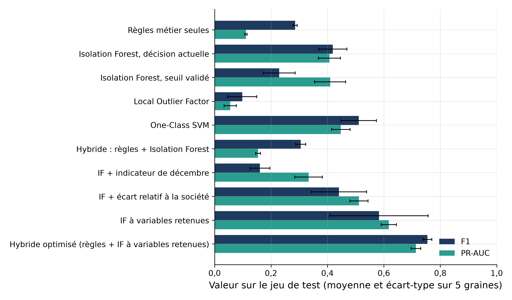

**Légende proposée** : F1 et PR-AUC de chaque approche sur le jeu de test (barres d'erreur : écart-type sur 5 graines).

**Interprétation** : Le classement par F1 et par PR-AUC est cohérent. En bas, les règles seules et le Local Outlier Factor restent sous 0,3 de F1. Les trois variantes de l'Isolation Forest qui ajoutent une information utile (écart relatif à la société, variables retenues, combinaison avec les règles) progressent à chaque étape, de 0,23 à 0,44, puis 0,58, puis 0,75. L'indicateur de décembre, lui, dégrade le résultat (0,16 contre 0,23). L'écart-type est élevé pour les variantes sans règles (jusqu'à 0,17 sur le F1), car leur seuil dépend du tirage ; l'hybride est le plus stable (0,02) parce que les règles détectent avec certitude une partie des anomalies. Les barres d'erreur invitent à ne pas sur-interpréter les écarts entre variantes proches.

### 4.2 Variantes pour le 13e mois

**Légende proposée** : Analyse des variantes « indicateur de décembre » et « écart relatif à la société ».

**Interprétation** : Ajouter à l'Isolation Forest un indicateur de décembre, pour absorber le 13e mois, n'améliore pas le résultat : le F1 passe de 0,23 à 0,16 et les faux positifs de 71 à 129 pour 1 000 fiches. Avec un seul mois de décembre dans l'entraînement, l'indicateur isole ce mois dans son ensemble au lieu de décrire un comportement propre aux sociétés concernées : sur la graine de référence, 99 % des 13e mois sont signalés (contre 70 % sans l'indicateur) et les fiches de décembre sans 13e mois le sont aussi plus souvent (3 % contre 0,7 %). À l'inverse, rapporter l'écart à l'historique de chaque salarié à la médiane de sa société pour le mois traite l'effet collectif sans connaître le calendrier : un 13e mois ou une augmentation générale décale toute la société, pas un salarié isolé. Cette variable porte le F1 à 0,44 et la PR-AUC à 0,51. Elle présente en outre l'avantage de ne nécessiter aucune donnée supplémentaire : elle se calcule sur le lot contrôlé. La leçon méthodologique est qu'une variable qui exprime la cause (effet collectif) vaut mieux qu'une variable qui désigne la période.

### 4.3 Ablation des variables

| Variable retirée | F1 (test) | PR-AUC (test) | Variation (test) | PR-AUC (validation) | Variation (validation) |
| :--- | ---: | ---: | ---: | ---: | ---: |
| Aucune (modèle complet) | 0,23 | 0,41 | — | 0,59 | — |
| Montant | 0,31 | 0,51 | +0,10 | 0,69 | +0,10 |
| Écart à la moyenne du salarié | 0,33 | 0,38 | -0,03 | 0,49 | -0,10 |
| Z-score dans la société | 0,26 | 0,46 | +0,05 | 0,69 | +0,11 |
| Variation sur le mois précédent | 0,21 | 0,36 | -0,05 | 0,48 | -0,10 |
| IBAN modifié | 0,20 | 0,35 | -0,06 | 0,54 | -0,05 |
| Paiements sur le même IBAN | 0,29 | 0,38 | -0,03 | 0,49 | -0,09 |

*Ablation des variables de l'Isolation Forest : performance après retrait d'une variable (moyenne sur 5 graines).*

**Légende proposée** : Ablation : performance de l'Isolation Forest quand on retire une variable (moyenne sur 5 graines).

**Interprétation** : Les variables les plus utiles sont IBAN modifié, variation sur le mois précédent, paiements sur le même IBAN : les retirer fait baisser la PR-AUC de 0,06 à 0,03 sur le test. À l'inverse, retirer montant ou z-score dans la société améliore la PR-AUC (par exemple 0,10 de variation en retirant montant). Le montant brut est en effet peu informatif lorsque les salaires vont de 1 500 à plus de 10 000 € : sur la graine de référence, 52 des 92 fiches normales signalées par la décision actuelle sont celles de dirigeants, qui ne représentent pourtant que 2,7 % des fiches normales. Le z-score dans la société souffre du même défaut. Les mêmes variables ressortent sur la validation, où la sélection a été faite : c'est ce qui permet de les écarter sans avoir regardé le test. Ce résultat dépend de l'hétérogénéité des profils du jeu synthétique, qu'il faudra confirmer sur des données réelles.

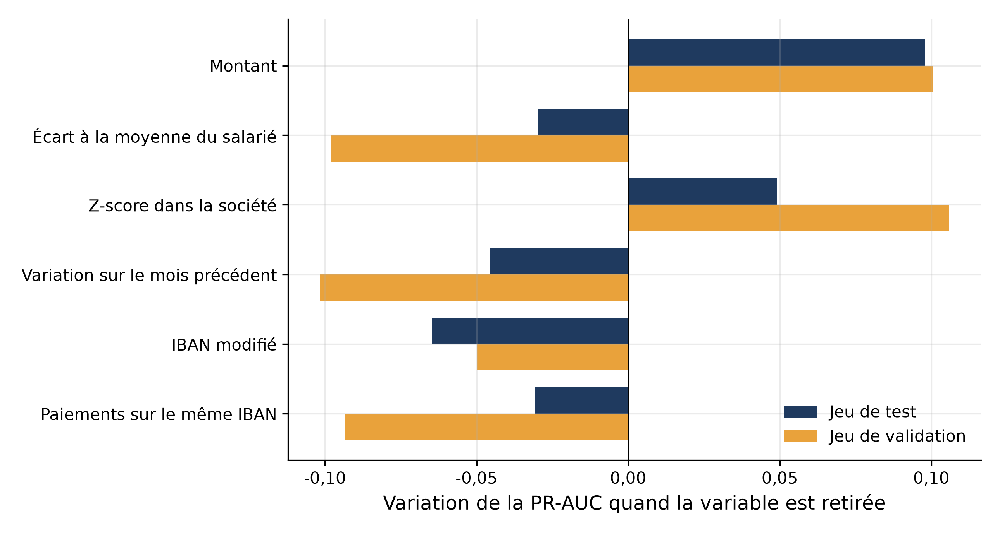

**Légende proposée** : Variation de la PR-AUC lorsqu'une variable est retirée de l'Isolation Forest (test et validation).

**Interprétation** : Une barre négative signale une variable utile (sa suppression dégrade la PR-AUC), une barre positive une variable qui gêne le modèle. Les barres du test et de la validation vont dans le même sens pour les six variables, ce qui valide la sélection faite sur la validation seule. Le montant brut et le z-score dans la société sont les deux variables nuisibles. L'indicateur d'IBAN modifié, la variation sur le mois précédent et le nombre de paiements sur le même IBAN sont parmi les plus utiles, l'écart à la moyenne du salarié étant à un niveau comparable. Cette lecture a servi à construire la variante à variables retenues.

### 4.4 Valeur ajoutée de l'IA

| Type d'anomalie | Anomalies (test) | Règles seules | IA seule | Règles et IA | Non détectées |
| :--- | ---: | ---: | ---: | ---: | ---: |
| Montant multiplié par 3 à 10 | 26 | 0,6 | 0,0 | 25,0 | 0,0 |
| Erreur de virgule (×100 ou ÷100) | 24 | 0,0 | 0,8 | 13,0 | 10,2 |
| Hausse subtile (+25 à +60 %) | 28 | 0,4 | 0,6 | 0,4 | 27,0 |
| Montant nul ou négatif | 30 | 20,8 | 0,0 | 9,6 | 0,0 |
| Doublon (salarié payé deux fois) | 27 | 25,6 | 0,0 | 1,6 | 0,0 |
| IBAN modifié et montant élevé | 28 | 0,0 | 9,4 | 18,4 | 0,0 |
| IBAN partagé entre deux salariés | 23 | 0,0 | 11,6 | 1,4 | 9,8 |
| Salarié fantôme (sans historique) | 29 | 0,0 | 0,0 | 0,0 | 28,6 |
| Salarié sorti encore payé | 27 | 0,0 | 0,0 | 0,0 | 26,6 |
| Total | 241 | 47,4 | 22,4 | 69,4 | 102,2 |

*Valeur ajoutée de l'IA : anomalies du jeu de test détectées par les règles seules, par l'IA seule (décision actuelle), par les deux, ou par aucune (nombre moyen de fiches par graine).*

**Légende proposée** : Valeur ajoutée de l'IA : anomalies détectées par les règles seules, par l'IA seule, par les deux, ou par aucune.

**Interprétation** : Sur environ 241 anomalies par jeu de test, 22 ne sont vues que par l'IA, soit 16 % des anomalies détectées, contre 47 vues seulement par les règles et 69 par les deux. Les types où l'IA apporte le plus sont IBAN partagé entre deux salariés, IBAN modifié et montant élevé, erreur de virgule (×100 ou ÷100). Les règles, elles, sont irremplaçables pour doublon (salarié payé deux fois) et montant nul ou négatif, qu'un modèle statistique distingue mal. En contrepartie, les règles produisent 423 fausses alertes que l'IA ne partage pas (les 13e mois), contre 72 pour l'IA seule. 102 anomalies échappent aux deux, principalement les salariés fantômes, les salariés sortis encore payés et les hausses subtiles : ces types exigent l'historique de présence du salarié. Les deux approches sont donc complémentaires, ce qui justifie l'hybride.

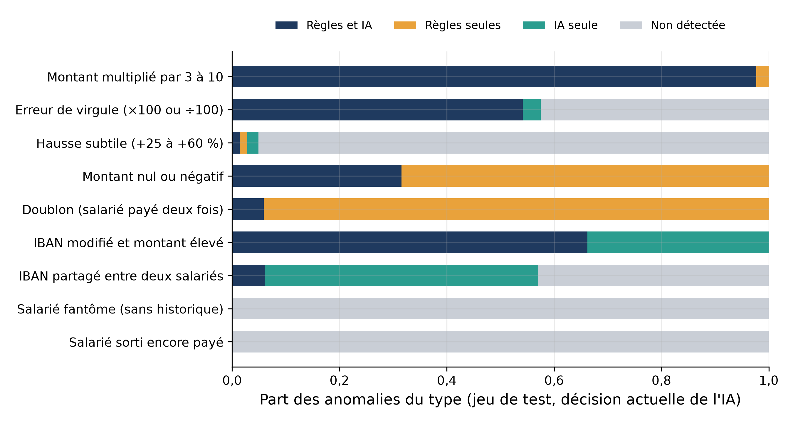

**Légende proposée** : Répartition des anomalies de chaque type selon le détecteur (règles, IA, les deux, aucun).

**Interprétation** : Le diagramme montre pour chaque type la part des anomalies vues par les deux détecteurs, par les règles seules, par l'IA seule ou par aucun. Les erreurs de montant importantes sont retrouvées par les deux approches, ce qui les rend robustes. Les anomalies qui ne contredisent aucune règle simple (IBAN partagé, erreur de virgule vers le bas) relèvent surtout de l'IA, ou ne sont détectées par personne. La partie grise, importante pour la hausse subtile, le salarié fantôme et le salarié sorti, désigne les anomalies non couvertes par le dispositif actuel et oriente les évolutions futures. Aucun des deux détecteurs ne suffit seul.

### 4.5 Détection par type et par approche

| Type d'anomalie | Règles métier seules | Isolation Forest, décision actuelle | One-Class SVM | Hybride : règles + Isolation Forest | IF à variables retenues | Hybride optimisé (règles + IF à variables retenues) |
| :--- | ---: | ---: | ---: | ---: | ---: | ---: |
| Montant multiplié par 3 à 10 | 100 % | 98 % | 88 % | 100 % | 100 % | 100 % |
| Erreur de virgule (×100 ou ÷100) | 54 % | 57 % | 67 % | 70 % | 100 % | 100 % |
| Hausse subtile (+25 à +60 %) | 3 % | 3 % | 1 % | 6 % | 75 % | 63 % |
| Montant nul ou négatif | 100 % | 28 % | 66 % | 100 % | 100 % | 100 % |
| Doublon (salarié payé deux fois) | 100 % | 6 % | 79 % | 100 % | 26 % | 100 % |
| IBAN modifié et montant élevé | 66 % | 100 % | 43 % | 88 % | 100 % | 100 % |
| IBAN partagé entre deux salariés | 7 % | 57 % | 92 % | 37 % | 49 % | 32 % |
| Salarié fantôme (sans historique) | 0 % | 0 % | 0 % | 0 % | 0 % | 0 % |
| Salarié sorti encore payé | 0 % | 0 % | 0 % | 0 % | 0 % | 0 % |

*Taux de détection (rappel) par type d'anomalie et par approche, jeu de test, moyenne sur 5 graines.*

**Légende proposée** : Taux de détection par type d'anomalie pour les principales approches (jeu de test).

**Interprétation** : Ce tableau détaille, type par type, ce que chaque approche détecte. Les règles métier atteignent un rappel complet sur les doublons et les montants nuls ou négatifs, ce que l'Isolation Forest actuel ne fait pas (6 % et 28 %). À l'inverse, l'Isolation Forest et le One-Class SVM sont meilleurs sur les IBAN modifiés et les IBAN partagés, que les règles ne voient pas. Retirer le montant brut des variables rend la hausse subtile détectable (63 à 75 % contre 3 %), et l'hybride optimisé atteint 100 % sur quatre autres types. Il reste un point faible : l'IBAN partagé n'est détecté qu'à un tiers, loin du One-Class SVM, ce qui appelle une règle explicite sur les IBAN communs à plusieurs salariés. Le salarié fantôme et le salarié sorti encore payé restent à 0 % pour toutes les approches.

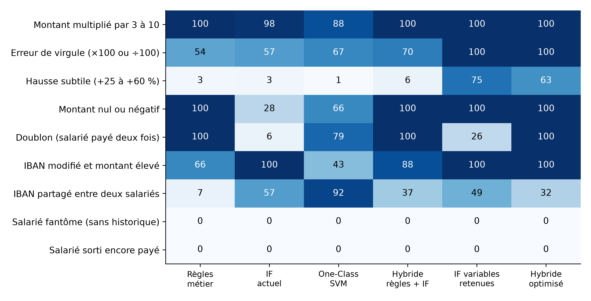

**Légende proposée** : Rappel par type d'anomalie (en %) pour les principales approches, jeu de test.

**Interprétation** : La carte de chaleur résume les complémentarités : les colonnes de règles sont foncées pour les doublons et les montants nuls, celles des modèles statistiques pour les IBAN. La colonne de l'hybride optimisé est la plus foncée dans l'ensemble, sauf pour l'IBAN partagé. Seules les deux dernières lignes (salarié fantôme, salarié sorti) restent entièrement claires, et la hausse subtile ne devient détectable qu'après retrait du montant brut. Les deux types sans détection appellent des informations nouvelles (historique de présence, rapprochement avec le registre du personnel) plutôt qu'un algorithme différent.

### 4.6 Justification du choix du modèle

**Légende proposée** : Justification du choix du modèle.

**Interprétation** : Nous recommandons l'hybride optimisé (règles métier et Isolation Forest sur cinq variables) : sur le test, il détecte 66 % des anomalies avec une précision de 88 %, contre 38 % et 47 % pour la décision actuelle, et réduit les faux positifs de 9 à 2 pour 1 000 fiches. Ce choix n'a utilisé que la validation (sélection des variables et du seuil) ; il est aussi le meilleur sur la validation. Il ne dépend pas d'un algorithme sophistiqué : le One-Class SVM est une alternative crédible, et le gain provient surtout des règles métier, de la suppression des variables nuisibles et de la normalisation par société. L'IA apporte une valeur propre : 22 anomalies par jeu de test, soit 16 % des anomalies détectées, échappent aux règles, alors que les règles seules produisent 423 fausses alertes que l'IA ne partage pas (contre 72 pour l'IA seule). Réserves : les données sont synthétiques et les anomalies injectées par des règles connues ; les performances réelles devront être mesurées lors d'un pilote. Ce modèle est préparé comme version candidate (voir `benchmark/candidat_v2/`) et n'est pas activé : le modèle en service reste inchangé.

## 5. Intégration de l'IA dans l'application (étape C)

### 5.1 Intégration de l'IA dans le parcours utilisateur

**Légende proposée** : Intégration de l'IA dans le parcours utilisateur.

**Interprétation** : L'IA est intégrée au parcours existant sans le bloquer ni le dupliquer. Lors du contrôle d'un fichier, l'Expert RH obtient, en plus des contrôles métier et de la validation XSD, une analyse IA de chaque fiche ; le résultat est conservé avec le fichier. La synthèse résume l'analyse, la sous-page « Contrôle IA » la détaille fiche par fiche avec une explication et une recommandation, et le Manager retrouve les mêmes informations lors de la validation, ce qui sert le principe des quatre yeux. Si l'IA est indisponible, le parcours continue et le signale. Les rôles sont respectés : l'administrateur supervise la qualité du modèle et voit des indicateurs agrégés, sans jamais accéder aux données des salariés, tandis que l'Expert RH et le Manager travaillent sur les fiches. L'IA reste une aide à la décision : elle signale, l'humain tranche.

### 5.2 Qualité du modèle (administrateur)

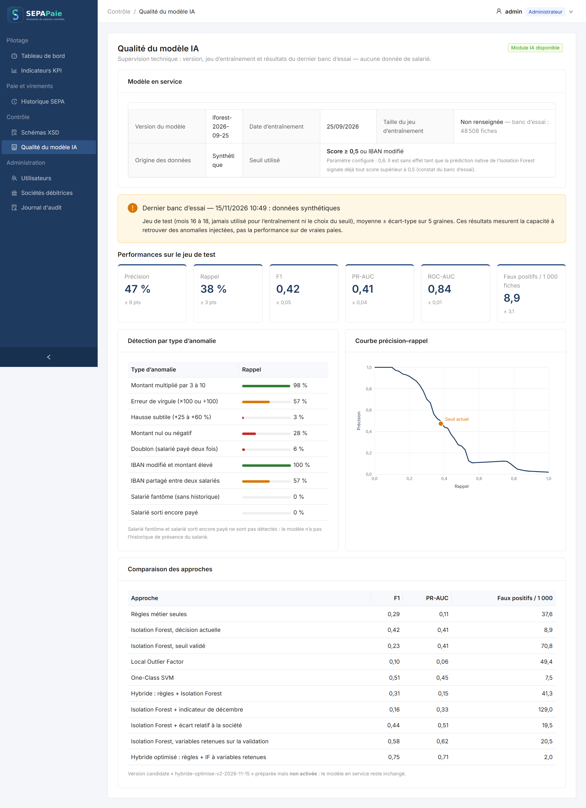

**Légende proposée** : Page « Qualité du modèle IA » (administrateur) : version, date d'entraînement, seuil, performances du banc d'essai, détection par type d'anomalie et courbe précision–rappel.

**Interprétation** : Cette page de supervision technique est réservée à l'administrateur. Elle affiche la version du modèle en service, sa date d'entraînement, la taille de son jeu d'entraînement et le seuil effectivement appliqué, puis les résultats du dernier banc d'essai lus dans le fichier de résultats : précision, rappel, F1, PR-AUC, charge de faux positifs, taux de détection par type d'anomalie et courbe précision–rappel avec le point de fonctionnement actuel. Un bandeau rappelle que les mesures portent sur des données synthétiques. La page ne contient aucune donnée de salarié : elle répond au besoin de l'administrateur de superviser le modèle sans accéder à la paie.

### 5.3 Contrôle IA d'un fichier (Expert RH et Manager)

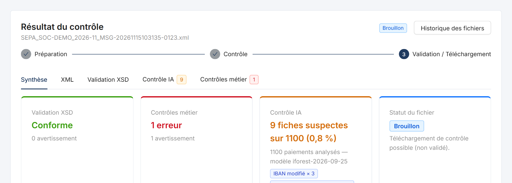

**Légende proposée** : Synthèse du résultat d'un fichier : carte « Contrôle IA » avec le nombre de fiches suspectes, leur part et la répartition par type probable.

**Interprétation** : La synthèse du fichier regroupe quatre cartes cliquables : validation XSD, contrôles métier, contrôle IA et statut. La carte IA indique le nombre de fiches suspectes sur le nombre de fiches analysées, le pourcentage correspondant, la version du modèle et la répartition par type probable d'anomalie. L'Expert RH ou le Manager voit ainsi en un coup d'œil ce que l'IA a relevé, et peut ouvrir le détail d'un clic. Si le module IA est indisponible, la carte l'indique et le fichier reste exploitable avec les seuls contrôles métier et la validation XSD.

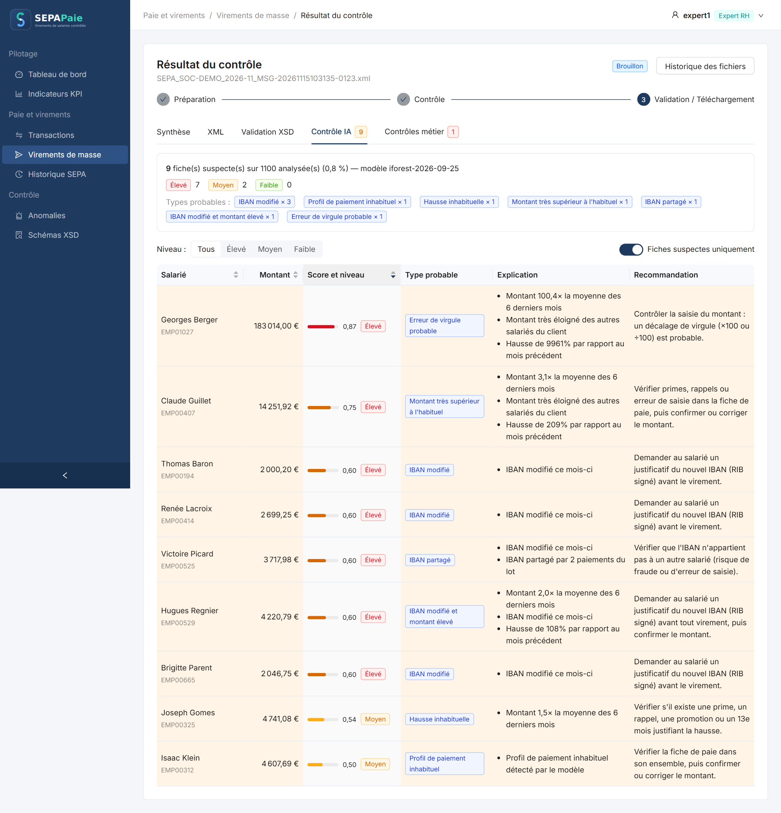

**Légende proposée** : Sous-page « Contrôle IA » : fiches suspectes triées par score, avec niveau, type probable, explication et recommandation.

**Interprétation** : Pour chaque fiche suspecte, la sous-page affiche le score et son niveau (faible, moyen ou élevé), le type d'anomalie probable, une explication en langage clair (par exemple « Montant 3,1× la moyenne des 6 derniers mois » ou « IBAN modifié ce mois-ci ») et une recommandation de correction adaptée au type. Le tableau est trié par score décroissant et peut être filtré par niveau. L'explication traduit les variables qui ont conduit le modèle à signaler la fiche : l'utilisateur sait quoi vérifier et pourquoi, ce qui rend la décision (corriger, confirmer ou ignorer) rapide et traçable.

### 5.4 Indicateurs KPI de l'apport de l'IA

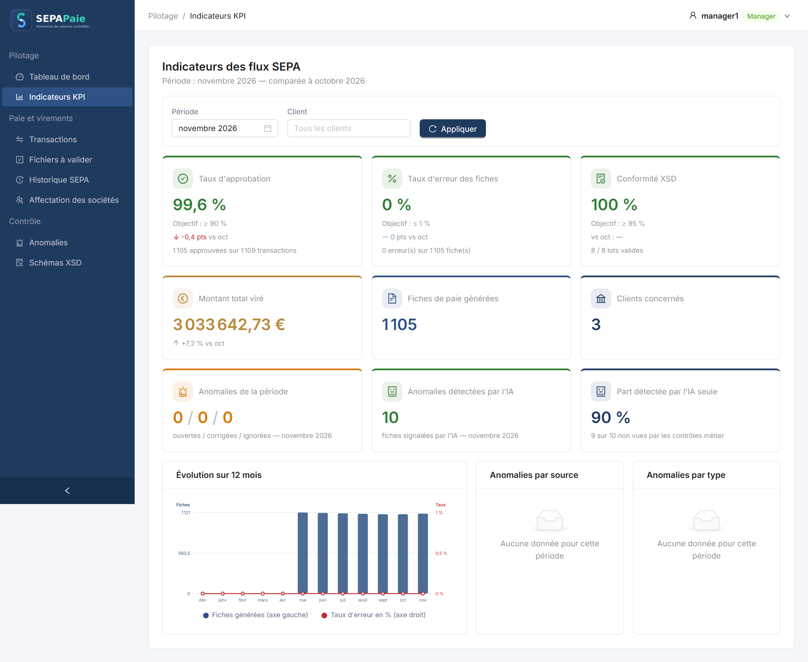

**Légende proposée** : Tableau de bord KPI : cartes « Anomalies détectées par l'IA » et « Part détectée par l'IA seule ».

**Interprétation** : Deux indicateurs du tableau de bord KPI mesurent l'apport de l'IA sur la période choisie : le nombre de fiches signalées par l'IA et la part de celles que les contrôles métier ne signalent pas (IBAN ou BIC invalide, montant nul ou négatif, doublon). Cette seconde valeur chiffre la valeur ajoutée de l'IA face aux règles, comme l'analyse de la section 4. Les chiffres sont calculés sur la dernière analyse de chaque fiche ; en l'absence de fiche signalée, la part est indisponible (« — ») et non nulle.

### 5.5 Scénario de soutenance

| Anomalie connue | Matricule | Contrôle IA | Autre contrôle |
| :--- | :--- | :--- | :--- |
| Montant multiplié par 3 à 10 | EMP00407 | Oui — élevé (0,75), montant très supérieur à l'habituel | — |
| Erreur de virgule (×100) | EMP01027 | Oui — élevé (0,87), erreur de virgule probable | — |
| Erreur de virgule (÷100) | EMP00941 | Non | — |
| Hausse subtile | EMP00325 | Oui — moyen (0,54), hausse inhabituelle | — |
| IBAN modifié et montant élevé | EMP00529 | Oui — élevé (0,60), IBAN modifié et montant élevé | — |
| IBAN partagé (1re fiche) | EMP00525 | Oui — élevé (0,60), IBAN partagé | — |
| IBAN partagé (2e fiche) | EMP00731 | Non | — |
| Montant nul ou négatif | EMP00252 | Non | Contrôle métier : erreur (montant nul) |
| Doublon (2 fiches) | EMP00284 | Non | Contrôle métier : avertissement de doublon |
| Salarié fantôme | EMP01122 | Non | — |
| Salarié sorti encore payé | EMP00129 | Non | — |

*Scénario de soutenance : 12 fiches anormales connues dans un fichier de 1 100 fiches, et ce que l'application signale avec le modèle en service.*

**Légende proposée** : Résultat du scénario de soutenance avec le modèle en service (fichier de 1 100 fiches, 12 anomalies connues).

**Interprétation** : Sur le fichier de démonstration, le contrôle IA signale 9 fiches sur 1100 (0,8 %), dont 5 sont de vraies anomalies parmi les 12 connues : les erreurs qui déforment le montant ou touchent l'IBAN sont retrouvées, avec une explication lisible et un type probable. Les contrôles métier complètent ce résultat en signalant le montant nul (erreur) et le doublon (avertissement), que l'IA seule ne voit pas. Quatre fiches signalées par l'IA sont des fausses alertes : trois changements d'IBAN légitimes, que la règle « IBAN modifié » signale systématiquement pour vérification, et une fiche au profil inhabituel. Restent non détectés l'IBAN partagé de la seconde fiche, l'erreur de virgule vers le bas, le salarié fantôme et le salarié sorti encore payé, conformément aux limites mesurées dans l'évaluation (sections 3 et 4). Ce scénario illustre donc l'apport de l'IA, sans en cacher les limites.

## Reproduction

Depuis le dossier `ai-module/` (environnement virtuel avec `pip install -r benchmark/requirements-benchmark.txt`) :

```
python -m benchmark.describe_dataset          # étape 0 : jeu de données, scénario de soutenance
python -m benchmark.evaluate_full             # étape A : évaluation du modèle (5 graines, ~1 min)
python -m benchmark.compare                   # étape B : comparaison des approches (~8 min ; --cache pour les livrables seuls)
python -m benchmark.exporter_candidat         # étape B : version candidate (non activée)
python -m benchmark.importer_scenario         # étape C : import du scénario de soutenance (application lancée)
node benchmark/capturer_ecrans.mjs <dossier>  # étape C : captures d'écran (puppeteer-core + Edge)
python -m benchmark.livrables_c               # étape C : textes, tableau et section du rapport
```
